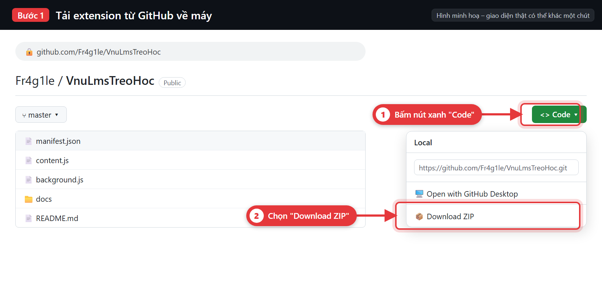
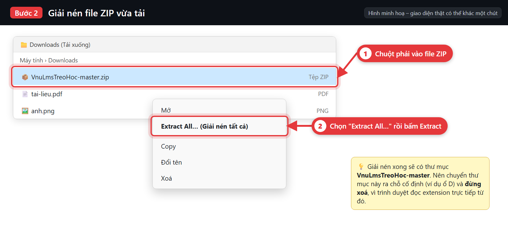
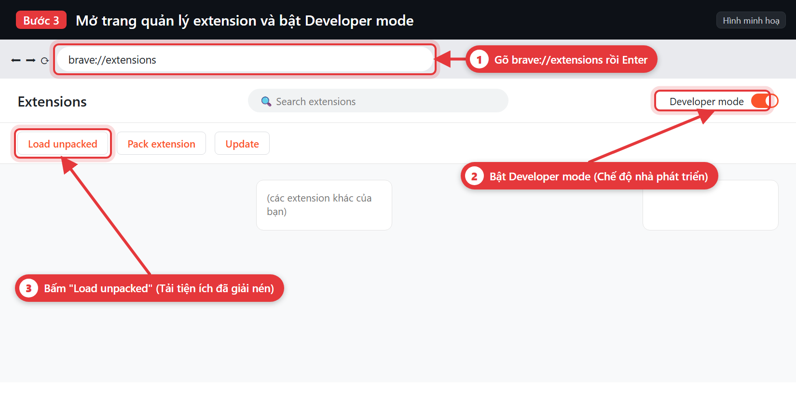
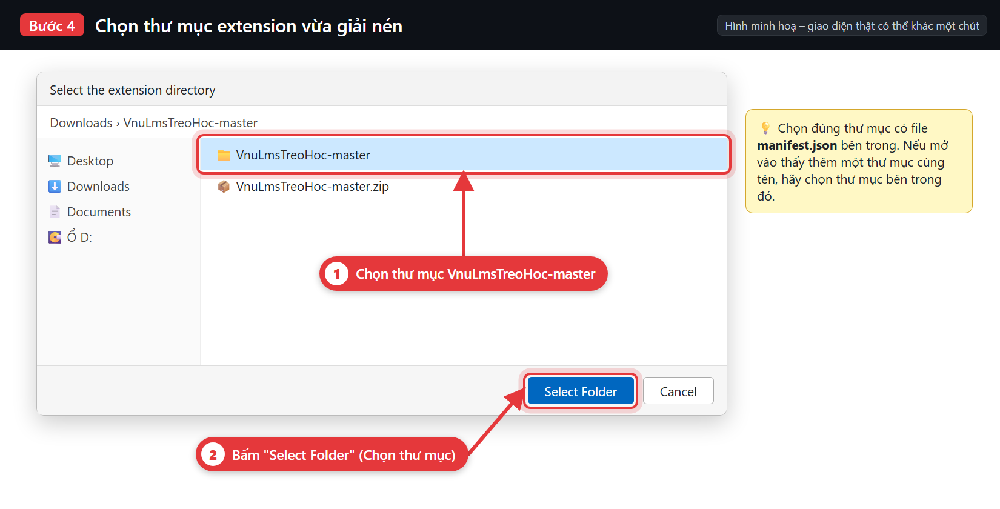
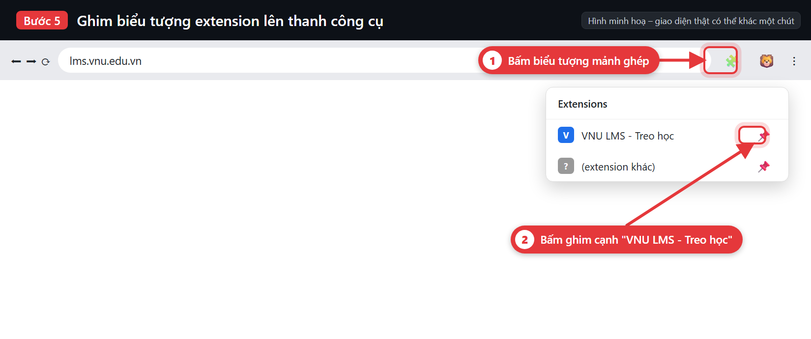
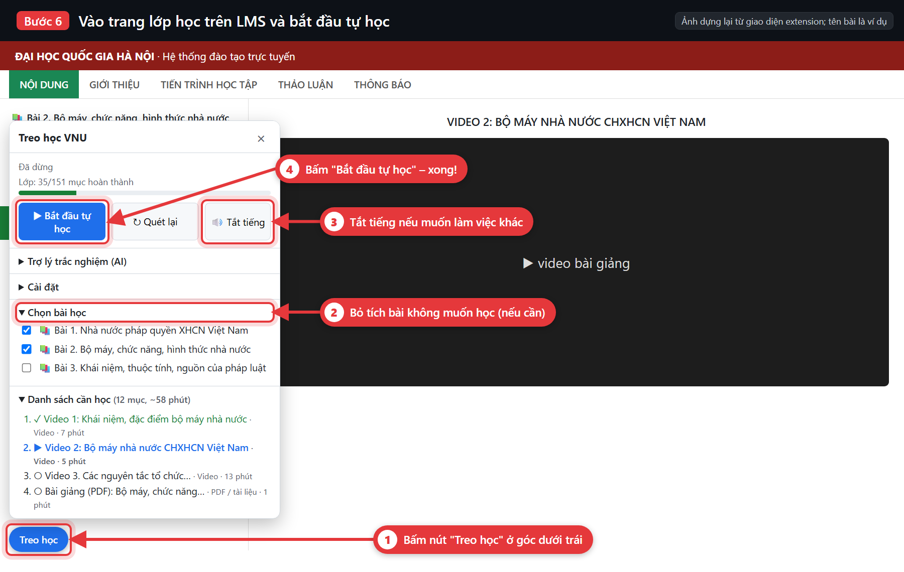
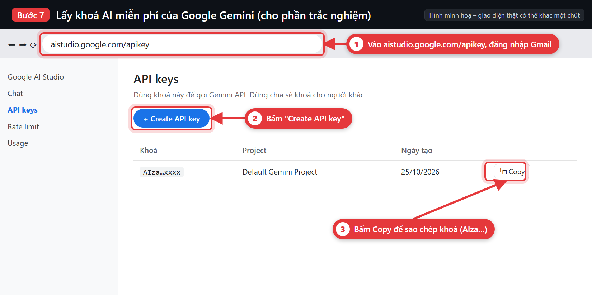
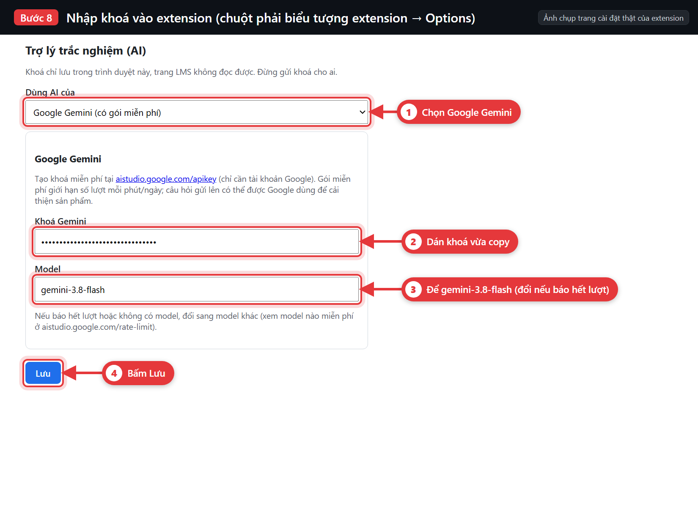
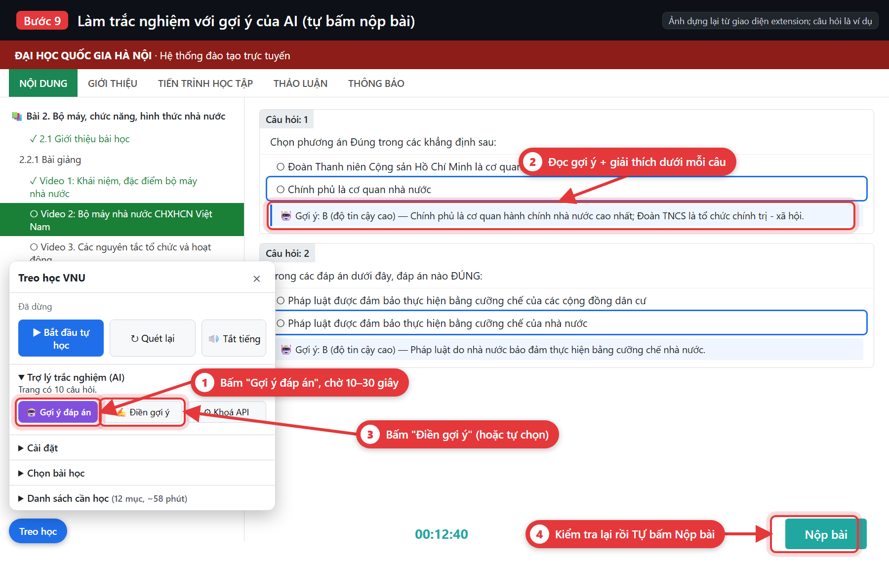

# Hướng dẫn cài và dùng "VNU LMS - Treo học" cho người mới

Làm trên **máy tính** (Windows/Mac) với trình duyệt **Brave**, **Chrome** hoặc **Edge**. Điện thoại không cài được extension.

Mất khoảng **5 phút**. Làm lần lượt từ trên xuống, mỗi bước có ảnh, **mũi tên đỏ chỉ vào nút cần bấm**.

- [Phần A – Cài extension](#phần-a--cài-extension-làm-một-lần)
- [Phần B – Treo học tự động](#phần-b--treo-học-tự-động)
- [Phần C – Gợi ý đáp án trắc nghiệm bằng AI (tuỳ chọn)](#phần-c--gợi-ý-đáp-án-trắc-nghiệm-bằng-ai-tuỳ-chọn)
- [Cập nhật bản mới](#cập-nhật-bản-mới)
- [Gặp lỗi?](#gặp-lỗi)

---

## Phần A – Cài extension (làm một lần)

### Bước 1. Tải extension về máy

**Cách nhanh nhất:** vào **https://github.com/Fr4g1le/VnuLmsTreoHoc/releases/latest**, kéo xuống mục **Assets**, bấm file **`VnuLmsTreoHoc-vX.Y.zip`** để tải. File này chỉ chứa đúng phần extension, nhẹ hơn.

**Hoặc** vào trang repo, bấm nút xanh **Code** rồi chọn **Download ZIP** (tải cả mã nguồn và hướng dẫn):

### Bước 2. Giải nén

Mở thư mục **Downloads**, **chuột phải** vào file ZIP vừa tải (`VnuLmsTreoHoc-vX.Y.zip` hoặc `VnuLmsTreoHoc-master.zip`; bên trong là thư mục `VnuLmsTreoHoc`) → **Extract All…** (Giải nén tất cả) → **Extract**. Ở Bước 4, chọn thư mục có file `manifest.json` bên trong.

Nên chuyển thư mục vừa giải nén ra chỗ cố định (ví dụ `D:\VnuLmsTreoHoc`) và **đừng xoá nó**, vì trình duyệt chạy extension trực tiếp từ thư mục này.

### Bước 3. Mở trang quản lý extension

1. Gõ vào thanh địa chỉ rồi Enter:
   - Brave: `brave://extensions`
   - Chrome: `chrome://extensions`
   - Edge: `edge://extensions`
2. Bật **Developer mode** (Chế độ dành cho nhà phát triển) ở góc trên bên phải.
3. Bấm **Load unpacked** (Tải tiện ích đã giải nén).

### Bước 4. Chọn thư mục extension

Chọn thư mục **VnuLmsTreoHoc-master** (thư mục có file `manifest.json` bên trong) rồi bấm **Select Folder** (Chọn thư mục).

Nếu báo lỗi "Manifest file is missing", nghĩa là bạn chọn nhầm thư mục ngoài: mở vào trong một cấp rồi chọn lại.

### Bước 5. Ghim biểu tượng lên thanh công cụ

Bấm biểu tượng **mảnh ghép 🧩** trên thanh công cụ, rồi bấm **ghim 📌** cạnh "VNU LMS - Treo học".

Xong phần cài đặt.

---

## Phần B – Treo học tự động

### Bước 6. Bắt đầu tự học

1. Đăng nhập **lms.vnu.edu.vn**, mở **trang chi tiết lớp học** (trang có cây mục lục bên trái).
2. Bấm nút **Treo học** ở **góc dưới bên trái** trang để mở bảng điều khiển.
3. Trong **Chọn bài học**, bỏ tích các bài bạn không muốn chạy (nếu cần).
4. Muốn làm việc khác thì bấm **🔊 Tắt tiếng**.
5. Bấm **▶ Bắt đầu tự học**.

Extension sẽ tự mở lần lượt từng mục chưa hoàn thành (video, PDF, bài đọc), treo đủ số phút mà LMS yêu cầu, tự xác nhận hộp thoại "Bạn có đang học tập không ?" và tự chuyển sang mục kế tiếp. Nó **không bao giờ tự mở bài kiểm tra**.

**Để treo ổn định:**

- Để cửa sổ trình duyệt **rộng** (từ 992px trở lên). Cửa sổ hẹp thì trang ẩn cây mục lục và extension sẽ tạm chờ.
- **Không thu nhỏ** cửa sổ (minimize); để nó nằm sau các cửa sổ khác thì được.
- **Không để máy ngủ**: Windows → Settings → System → Power → Sleep: **Never**.
- Riêng **Brave**:
  - Vào `brave://settings/system` → **Memory Saver** → **Add** → nhập `lms.vnu.edu.vn` (để tab không bị cho ngủ).
  - Ở trang LMS, bấm ổ khoá cạnh thanh địa chỉ → **Site settings** → **Autoplay** → **Allow** (cho video tự phát).

---

## Phần C – Gợi ý đáp án trắc nghiệm bằng AI (tuỳ chọn)

Cần một **khoá AI**. Khoá của **Google Gemini** là **miễn phí**, chỉ cần tài khoản Gmail.

### Bước 7. Lấy khoá Gemini miễn phí

1. Vào **https://aistudio.google.com/apikey**, đăng nhập bằng Gmail cá nhân (tài khoản trường có thể bị chặn).
2. Bấm **Create API key**.
3. Bấm **Copy** để sao chép khoá (bắt đầu bằng `AIza…`).

> **Giữ bí mật khoá**, không gửi cho ai. Lỡ lộ thì vào lại trang trên để xoá khoá.

### Bước 8. Nhập khoá vào extension

**Chuột phải** biểu tượng extension trên thanh công cụ → **Options** (hoặc bấm **⚙ Khoá API** trong bảng Treo học).

1. Ở "Dùng AI của", chọn **Google Gemini**.
2. Dán khoá vào ô **Khoá Gemini**.
3. Để model là `gemini-3.8-flash`. Nếu sau này báo "hết lượt" hoặc "không có model", đổi sang `gemini-3.6-flash`, `gemini-3.5-flash-lite` hoặc `gemini-2.5-flash`.
4. Bấm **Lưu**.

Muốn chính xác hơn có thể chọn **Anthropic Claude** (trả phí, tạo khoá tại platform.claude.com).

### Bước 9. Làm bài với gợi ý

1. Mở bài trắc nghiệm, bấm **LÀM BÀI**.
2. Trong bảng Treo học, bấm **🤖 Gợi ý đáp án**, chờ 10–30 giây.
3. Đọc gợi ý: đáp án gợi ý có **khung xanh**, dưới mỗi câu có giải thích.
4. Bấm **✍ Điền gợi ý** (hoặc tự chọn).
5. **Kiểm tra lại rồi tự bấm Nộp bài**. Extension không bao giờ tự nộp.

AI có thể sai, nhất là câu hỏi kiểu "đáp án nào SAI". Gợi ý được lưu lại: làm lại bài gặp câu giống hệt sẽ dùng luôn, không tốn lượt AI.

---

## Cập nhật bản mới

Khi có bản mới, biểu tượng extension hiện chữ **NEW**, nút "Treo học" có dấu **⬆**, và trong bảng có dòng xanh **"Có bản mới vX.Y"** kèm nút **Tải bản mới** (extension tự kiểm tra GitHub, tối đa 6 tiếng một lần).

1. Bấm **Tải bản mới** (hoặc tải ZIP như **Bước 1**). Trong zip luôn là thư mục **`VnuLmsTreoHoc`**: giải nén **đè lên** thư mục cũ.
2. Vào `brave://extensions` (hoặc `chrome://extensions`), bấm **⟳** ở thẻ "VNU LMS - Treo học".

Từ **v2.9**, extension có mã ID cố định (`phjfhfofmfgcdellcpndceejfkkkjjhj`) nên **khoá AI và cài đặt không bị mất** khi cập nhật, kể cả khi giải nén ra thư mục khác.

> **Lên v2.9 từ bản cũ (làm một lần):** ở trang extensions, bấm **Remove** (Xoá) **tất cả** thẻ "VNU LMS - Treo học" cũ, rồi **Load unpacked** thư mục `VnuLmsTreoHoc` của bản v2.9 và nhập lại khoá AI **lần cuối**. Kiểm tra mã ID trên thẻ phải là `phjfhfofmfgcdellcpndceejfkkkjjhj`.

Extension cài từ thư mục **không tự cập nhật được** (giới hạn của trình duyệt), nên vẫn cần làm 2 bước trên mỗi khi có bản mới.

## Gặp lỗi?

| Hiện tượng | Cách xử lý |
|---|---|
| Không thấy nút "Treo học" trên trang | Kiểm tra extension đang bật ở trang extensions, rồi tải lại trang LMS (F5) |
| Báo "Cửa sổ hẹp…" | Phóng to cửa sổ trình duyệt |
| Mục bị ⚠ "Không tìm thấy/mở được" | Bài đó chưa mở theo tuần, hoặc mục lục chưa hiện; extension tự bỏ qua |
| "Khoá Gemini không hợp lệ" | Copy lại khoá ở Bước 7, dán lại ở Bước 8 |
| "hết lượt miễn phí" / "không có model" | Chờ vài phút, hoặc đổi model ở Bước 8 |
| Trình duyệt hỏi tắt "extension ở chế độ nhà phát triển" | Bấm giữ lại / Cancel; đây là cảnh báo bình thường với extension cài từ thư mục |
| Bảng hiện cảnh báo đỏ **💤 "Tab LMS vừa bị ngưng…"** / **"đã cho tab LMS ngủ"** | Trình duyệt đã cho tab ngủ nên lúc đó không được tính giờ. Bấm **"Cách sửa"** trong cảnh báo và làm theo (thêm `lms.vnu.edu.vn` vào danh sách luôn hoạt động của Memory Saver / Sleeping tabs, tắt Energy Saver). Máy tính ngủ cũng gây cảnh báo này: chỉnh Sleep thành Never. |
